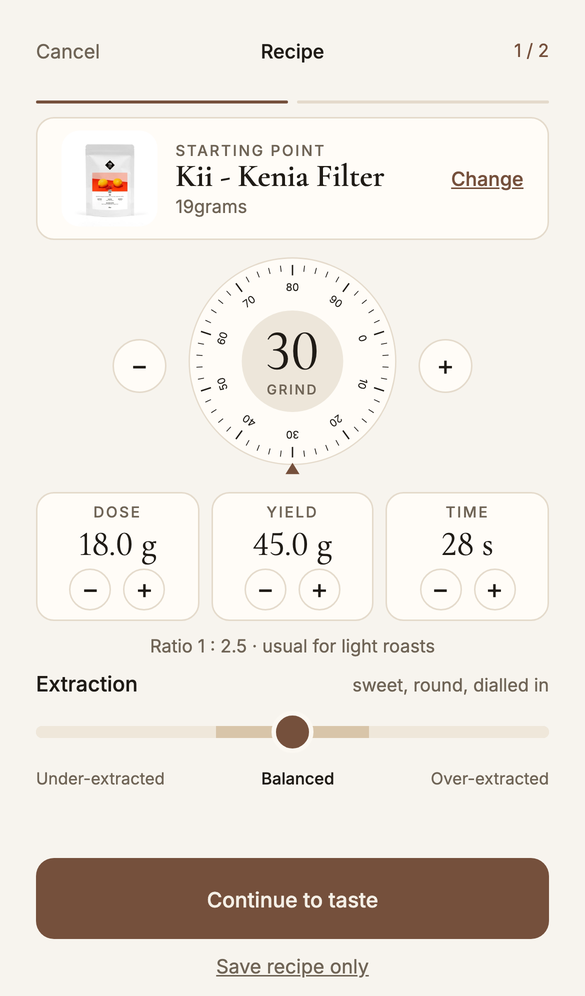
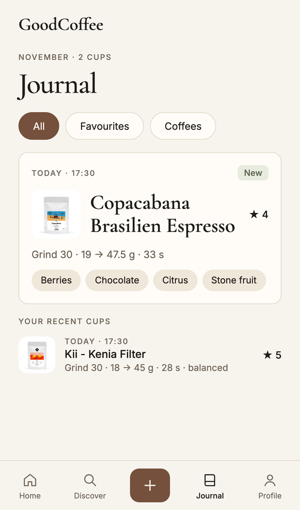
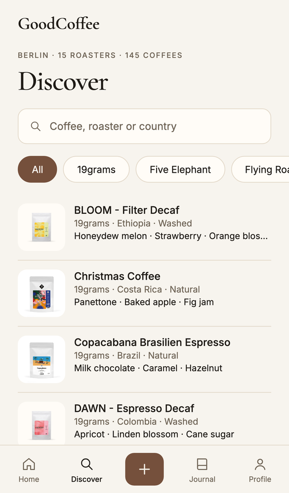
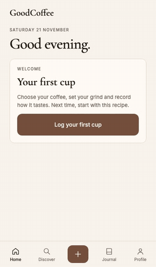

# GoodCoffee

**An app for home baristas, who want a better espresso every day.**

<p align="center">
  
  &nbsp;
  
  &nbsp;
  
</p>

Three core customer pains solved:

**➕ Log** — the button in the middle. Record today's shot: grind, dose, yield, time and taste. The next shot starts from the last one, so you know exactly what to change so the next espresso is perfectly dialed in.

**📖 Journal** — your personal archive of every shot and every bean, and how it tasted. Add a bean by snapping the bag: an LLM reads it, finds the coffee in the catalogue or the roaster's shop and saves origin, producer, brewing recipe and the official product photo.
*[AI Feature Eval](docs/eval.md):* on an eval set of 30 coffee photos, better matching raised correct recognition from 47 % to 87 %, with zero wrong coffees.

**🔍 Discover** — a Supabase database of 140+ specialty coffees from Berlin roasters. Search by coffee, roaster, country or region, and compare tasting notes to find one you'll like.

**Status:** A personal project to test agentic engineering: what's possible and how to work with AI agents best. Built with Claude Code, with a conductor agent that splits the work into individual tasks; Codex (Astra) did the code reviews.

**Tech:** Expo (React Native, iOS and Android) · Supabase (Postgres with row-level security, anonymous auth, Edge Functions) · OpenAI vision model reads the bag, OpenAI web search finds the roaster's product page · offline-first sync.

**Learnings**
- **Evals to define success.** In order to test how well a feature functions and that the correct goal is achieved, write a precise eval.
- **One Agent Orchestrator** A coordinator splitting work into clearly scoped tasks with a definition of done worked better than one big agent.
- **A second model as reviewer.** Reviews by another model (here GPT Astra 6 in Codex) caught bugs the building agent missed.
- **LLM has direct access to UI** By having access to the UI the AI can test features itself and find bugs instead of coding from an ivory tower


Short demo of logging an espresso shot.
<p align="center">
  
</p>


<sub>More: [competition analysis](docs/competition.md) · [AI feature eval](docs/eval.md)</sub>

<sub>Coffee names, tasting notes and product photos in the catalogue come from the roasters' public shop pages and belong to the roasters. Product photos are linked, not copied into this repository.</sub>

## Codebase

The app on the phone keeps your journal and works offline. When online, it syncs with a database in the cloud (Supabase). Scanning a bag sends the photo to a small server function, which asks an AI model what coffee it is.

```
src/app/              The screens you see in the app
src/components/       Reusable pieces of those screens (buttons, grind dial, cards)
src/data/ · src/lib/  The app's memory and rules: saving, syncing, recognising coffees
supabase/             The cloud side: database, coffee catalogue, AI scan functions
tests/ · scripts/     Automatic checks that everything still works, and the AI evals
```
